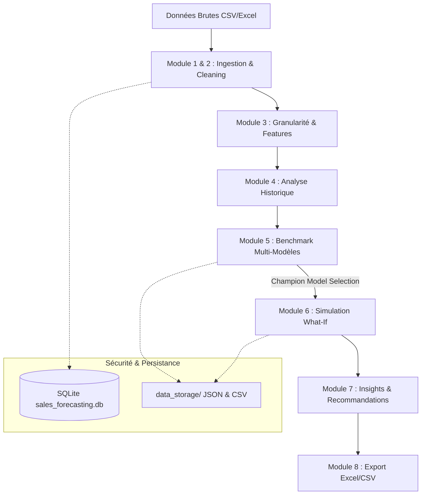

# 📈 FORCASTA — Intelligent Commercial Sales Forecasting Platform

<div align="center">


**Application Web d'Aide à la Décision Stratégique & Prévision de Séries Temporelles Commerciales**

[Fonctionnalités](#-fonctionnalités-clés) • [Architecture](#-architecture-technique) • [Démarrage Rapide](#-démarrage-rapide) • [Déploiement](#-déploiement-cloud--docker) • [Structure](#-structure-du-projet)

</div>

---

## 🌟 Présentation

**FORCASTA** est une plateforme analytique d'entreprise conçue pour transformer les données historiques de ventes en prévisions fiables et en recommandations d'affaires actionnables.

Conçue avec une interface moderne bilingue (**Français / Anglais**) et un support natif **Thème Sombre / Thème Clair**, l'application guide l'utilisateur à travers un pipeline méthodologique complet, depuis le nettoyage des données brutes jusqu'à la simulation d'impact commercial (promotions, ruptures, lancements).

---

## ✨ Fonctionnalités Clés

### 🔐 1. Authentification & Gestion Multi-Projets
- Authentification sécurisée par mot de passe haché (`bcrypt`).
- Espace de travail multi-projets isolé par utilisateur dans SQLite.
- Console d'administration pour la gestion des comptes et privilèges.

### 🧹 2. Ingestion & Nettoyage Automatique des Données
- Support multi-format : **CSV** et **Excel (.xlsx, .xls)**.
- Détection intelligente des colonnes temporelles et des montants de ventes.
- Détection et imputation des valeurs aberrantes (outliers) et données manquantes.

### ⚙️ 3. Ingénierie des Variables & Granularités
- Agrégation temporelle flexible : **Quotidienne**, **Hebdomadaire**, **Mensuelle**, ou **Trimestrielle**.
- Génération automatique de retards temporels (*lags*), moyennes mobiles (*rolling stats*) et marqueurs calendaires.

### 🔍 4. Analyse Rétrospective & Décomposition
- Décomposition de séries temporelles : Tendance séculaire, saisonnalités et résidus.
- Analyse de l'impact des promotions passées et événements exceptionnels via visualisations interactives **Plotly**.

### 🤖 5. Benchmark Automatique de Modèles (AutoML Time-Series)
- Entraînement et comparaison simultanée de plusieurs familles d'algorithmes :
  - **Facebook Prophet** (saisonnalités multiples, jours fériés)
  - **ARIMA / SARIMAX** (modèles économétriques classiques)
  - **XGBoost / Random Forest** (arbres de décision avec régresseurs de tendance)
  - **Lissage Exponentiel (Holt-Winters)**
- Sélection automatique du modèle **Champion** selon l'erreur absolue moyenne en pourcentage (**MAPE**).

### 🔮 6. Simulation Scénarisée & What-If Analysis
- Injection d'événements futurs : hausses de prix, campagnes publicitaires, promotions ou chocs d'approvisionnement.
- Comparaison dynamique en temps réel : **Baseline (tendance pure)** vs **Scénario Simulé**.

### 💡 7. Recommandations Décisionnelles Intelligentes
- Synthèse automatique des opportunités et des risques de rupture de stock.
- Calcul de l'enveloppe de prévision avec intervalles de confiance à **80% et 95%**.

### 📥 8. Exports Exécutifs
- Téléchargement en 1-clic des prévisions détaillées et des rapports synthétiques en **Excel formaté** et **CSV**.

---

## 🏗️ Architecture Technique



### 🛠️ Stack Technologique
- **Interface Utilisateur :** Streamlit, CSS3 customisé (Palette Sky Mint & Graphite), Plotly Express & Graph Objects.
- **Data & Algorithmes :** Pandas, NumPy, Scikit-Learn, Statsmodels, Prophet, XGBoost.
- **Stockage & Sécurité :** SQLite3, Passlib (`bcrypt`), OpenPyXL.
- **Conteneurisation & Déploiement :** Docker, Streamlit Cloud, Render, Hugging Face Spaces.

---

## 🚀 Démarrage Rapide

### Prérequis
- Python 3.10 ou 3.11 installé
- Git (optionnel)

### Installation Locale

1. **Cloner le projet ou télécharger les sources :**
   ```bash
   git clone https://github.com/votre-nom/forcasta.git
   cd forcasta
   ```

2. **Créer et activer un environnement virtuel :**
   ```bash
   # Windows
   python -m venv .venv
   .\.venv\Scripts\activate

   # Linux / macOS
   python3 -m venv .venv
   source .venv/bin/activate
   ```

3. **Installer les dépendances :**
   ```bash
   pip install --upgrade pip
   pip install -r requirements.txt
   ```

4. **Lancer l'application :**
   ```bash
   streamlit run streamlit_app.py
   ```
   L'application s'ouvrira automatiquement à l'adresse : `http://localhost:8501`.

> 💡 **Sous Windows :** Vous pouvez également double-cliquer directement sur le lanceur rapide `lancer_forcasta_streamlit.bat`.

---

## ☁️ Déploiement (Cloud & Docker)

### Option A — Streamlit Community Cloud (Gratuit en 1-clic)
1. Poussez votre code sur un dépôt GitHub.
2. Rendez-vous sur [share.streamlit.io](https://share.streamlit.io).
3. Connectez votre dépôt et définissez :
   - **Main file path :** `streamlit_app.py`
4. Cliquez sur **Deploy!**

### Option B — Conteneur Docker (Render, Railway, VPS)
L'image Docker officielle est optimisée et prête à l'emploi grâce au `Dockerfile` inclus :

```bash
# Construire l'image Docker
docker build -t forcasta .

# Démarrer le conteneur avec volumes pour persister les données
docker run -d -p 8501:8501 \
  -v $(pwd)/database:/app/database \
  -v $(pwd)/data_storage:/app/data_storage \
  --name forcasta-app forcasta
```

Consultez le guide complet dans [DEPLOYMENT_GUIDE.md](DEPLOYMENT_GUIDE.md).

---

## 📁 Structure du Projet

```text
FORCASTA/
│
├── streamlit_app.py          # Application principale Streamlit (Pipeline modulaire)
├── requirements.txt          # Dépendances Python requises
├── Dockerfile                # Image de conteneurisation de production
├── .gitignore                # Exclusion des fichiers temporaires (.venv, caches)
├── DEPLOYMENT_GUIDE.md       # Guide pas-à-pas de mise en production
├── README.md                 # Documentation du projet (ce fichier)
│
├── .streamlit/
│   └── config.toml           # Configuration du serveur et du thème visuel
│
├── modules/                  # Moteurs métier et algorithmiques
│   ├── data_cleaning.py      # Détection, imputation et filtrage
│   ├── feature_engineering.py# Lags, agrégations et métriques
│   ├── models.py             # Implémentation Prophet, ARIMA, XGBoost
│   ├── historical_insights.py# Visualisations de saisonnalité
│   ├── simulation.py         # Moteur de simulation What-If
│   ├── recommendations.py    # Génération d'insights décisionnels
│   └── export_data.py        # Moteur d'exportation Excel/CSV
│
├── database/                 # Persistance des utilisateurs et projets
│   ├── db.py                 # Connecteur et schémas SQLite
│   └── sales_forecasting.db  # Base de données locale
│
├── utils/                    # Utilitaires d'interface et d'internationalisation
│   ├── auth.py               # Chiffrement et vérification bcrypt
│   ├── ui_components.py      # Éléments graphiques réutilisables
│   └── i18n_helper.py        # Dictionnaires et bascule FR / EN
│
└── data_storage/             # Stockage persistant des artefacts de projets
```

---

## 👤 Auteur & Licence

Développé pour l'analyse prédictive et la planification commerciale avancée.

Distribué sous licence **MIT**. Voir `LICENSE` pour plus d'informations.
